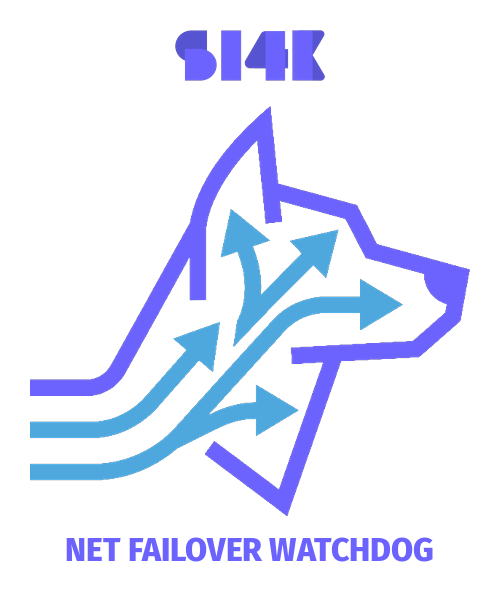

<p align="center">
  
</p>

<h1 align="center">net-failover-watchdog</h1>

<p align="center">
  <b>Health-aware Linux network failover daemon with configurable interface priorities, hysteresis, IPv4 route management, and connectivity verification</b><br>
  <sub><i>by SI4K</i></sub>
</p>

<p align="center">
  <a href="https://opensource.org/licenses/MIT"></a>
  <a href="https://archlinux.org"></a>
  
</p>

`net-failover-watchdog` is a lightweight, hardened multi-WAN failover engine designed for Linux desktops, laptops, and edge devices that switch between **Ethernet**, **USB tethering / cellular modems**, and **Wi-Fi**.

Unlike naive shell scripts that induce route flapping, poll dead interfaces sequentially, or blackhole traffic behind captive portals, `net-failover-watchdog` provides kernel-level route deduplication, asymmetric hysteresis, multi-tier health verification, and systemd-resolved DNS synchronization.

---

## Key Features

- **Sysfs Hardware Bus Introspection**: Deterministically classifies interfaces by physical hardware topology (`/pci...` Ethernet vs `/usb...` cellular/dongles vs `phy80211` Wi-Fi) rather than brittle device name regexes.
- **Dynamic CLI Priority Reconfiguration (`net-failover-watchdog-ctl`)**:
  - Reorder interface priorities on the fly via CLI (e.g. `lan > usb > wifi > other` or `usb > lan > wifi > other`).
  - Seamlessly handle multiple instances of physical links (multiple LAN cards, USB dongles, or Wi-Fi cards: `eth0 > usb0 > enp3s0 > wlan0`).
  - Hot-applies changes immediately: pauses the current monitoring cycle, reloads the configuration, and restarts route reconciliation with the new order.
- **Asymmetric Hysteresis State Machine**:
  - **Fast Failover**: Rapidly demotes a failing primary interface after configurable consecutive drops ($\Theta_{\text{fail}} = 3$ cycles $\approx$ 9s).
  - **Conservative Recovery**: Requires sustained error-free uptime ($\Theta_{\text{recovery}} = 10$ cycles $\approx$ 30s) before reinstating a recovered primary, eliminating route flapping on marginal links.
- **Multi-Tier Health Validation**:
  - **Physical Carrier Check**: Immediate transceiver state introspection via `/sys/class/net/<dev>/carrier`.
  - **Layer 3 Anycast Quorum**: Concurrent, asynchronous ICMP echo checks across independent Anycast ASNs (`1.1.1.1`, `8.8.8.8`, `9.9.9.9`, `208.67.222.222`) avoiding single-point probe anomalies.
  - **Layer 7 Captive Portal Egress**: Probes HTTP 204 endpoints (Google, Cloudflare) and Microsoft NCSI to detect exhausted cellular data plans and captive portal redirects.
- **Atomic FIB Route Management**:
  - Manages priority metrics (`50` for primary, `200` for standby, `500` for degraded).
  - Actively deduplicates unmanaged, unmetered, or rogue default routes re-injected by DHCP renewals (NetworkManager, systemd-networkd, dhcpcd).
  - Supports point-to-point and direct device default routes.
- **DNS Resolver Alignment**: Coordinates with `systemd-resolved` via `resolvectl` to re-align per-link routing domains and flush stale DNS negative caches upon failover.
- **Strict Reverse-Path Filtering Awareness**: Inspects effective `rp_filter` states, providing clear guidance and optional opt-in handling without altering global host defaults.
- **Production Systemd Sandboxing**: Ships with Linux capabilities (`CAP_NET_ADMIN`, `CAP_NET_RAW`), strict filesystem protection, and private temporary directories.

---

## Architecture & State Machine

```
                      +---------------------------------------+
                      |                                       |
                      v                                       |
            +--------------------+                            |
            |      PRIMARY       |                            |
            |    (Metric 50)     |                            |
            +--------------------+                            |
                      |                                       |
         Failures >=  |                        Successes >=   |
         Theta_Fail   |                        Theta_Recover  |
                      v                                       |
            +--------------------+                            |
            |      STANDBY /     |----------------------------+
            |      DEMOTED       |
            |    (Metric 200/    |
            |        500)        |
            +--------------------+
```

### Route Metric Hierarchy

| State | Metric | Description |
| :--- | :--- | :--- |
| **Primary** | `50` | Active default gateway handling all outbound traffic |
| **Backup / Standby** | `200` | Fully verified, healthy alternate uplink ready for instant failover |
| **Degraded** | `500` | Unresponsive or failing link retained for local recovery without blackholing traffic |

---

## Installation

### Arch Linux (AUR)

Once published on the Arch User Repository (AUR), install using your preferred AUR helper:

```bash
# Using paru
paru -S net-failover-watchdog

# Using yay
yay -S net-failover-watchdog
```

Or build manually from AUR:

```bash
git clone https://aur.archlinux.org/net-failover-watchdog.git
cd net-failover-watchdog
makepkg -si
```

### Manual Installation (From Source)

```bash
git clone https://github.com/Akshitkamboz13/net-failover-watchdog.git
cd net-failover-watchdog
sudo make install
```

---

## Quick Start & CLI Control

### 1. Enable and Start the Service

The package does **not** silently take over network routing upon installation. Start and enable the service when ready:

```bash
sudo systemctl enable --now net-failover-watchdog.service
```

### 2. Inspect Live Status

Check active interfaces, carrier states, gateway metrics, and hysteresis counters:

```bash
net-failover-watchdog-ctl status
```

### 3. Change Interface Priority on the Fly

You can dynamically reorder failover priorities using `net-failover-watchdog-ctl`. When a priority change is applied, the CLI automatically pauses and restarts the watchdog cycle with the new order:

#### Change Hardware Type Priority

Prioritize USB tethering over Ethernet:
```bash
# Space-separated (recommended):
sudo net-failover-watchdog-ctl priority set usb lan wifi other

# Or quoted when using '>' (quotes prevent shell output redirection):
sudo net-failover-watchdog-ctl priority set 'usb > lan > wifi > other'
```
*(Always quote `'>'` in shell commands to prevent Bash output redirection, or use space/comma separation: `usb lan wifi other`, `usb,lan,wifi,other`)*

#### Handle Multiple LANs, USB Modems, or Wi-Fi Cards

If your machine has multiple Ethernet ports, USB tethering devices, or Wi-Fi adapters, specify the exact interface order:
```bash
# Space-separated position-based priority (left to right = highest to lowest):
sudo net-failover-watchdog-ctl priority set eth0 usb0 enp3s0 wlan0

# Or quote-wrapped:
sudo net-failover-watchdog-ctl priority set 'eth0 > usb0 > enp3s0 > wlan0'

# Or assign explicit numeric weights (lower number = higher preference):
sudo net-failover-watchdog-ctl priority set eth0=1 usb0=2 enp3s0=3 wlan0=4
```

#### View Current Priority & Discovered Interfaces

```bash
net-failover-watchdog-ctl priority show
```

Example output:
```
Net Failover Watchdog — Priority Configuration

Hardware Type Priorities (lower value = higher priority)
  ┌──────────┬──────────┐
  │  Type    │  Weight  │
  ├──────────┼──────────┤
  │  LAN     │  1       │
  │  USB     │  2       │
  │  WIFI    │  3       │
  │  OTHER   │  4       │
  └──────────┴──────────┘

Detected Hardware Interfaces
  INTERFACE    CARRIER    DETECTED TYPE WEIGHT
  --------------------------------------------------
  enp5s0       UP         LAN (PCI)    1
  usb0         UP         USB/Cell     2
  wlan0        DOWN       Wi-Fi        3

  Service (systemd): active (running)
```

#### Revert to Default Configuration

```bash
sudo net-failover-watchdog-ctl priority reset
```

---

## Configuration Reference (`/etc/net-failover-watchdog.conf`)

| Option | Default | Description |
| :--- | :--- | :--- |
| `CHECK_INTERVAL` | `3` | Polling loop interval in seconds |
| `L3_TARGETS` | `("1.1.1.1" "8.8.8.8" "9.9.9.9" "208.67.222.222")` | Anycast targets for ICMP quorum |
| `L3_QUORUM` | `2` | Minimum responding targets required |
| `L3_TIMEOUT` | `1` | Per-target ping timeout in seconds |
| `L7_CHECK_ENABLED` | `true` | Enable HTTP 204 captive portal validation |
| `METRIC_PRIMARY` | `50` | Kernel FIB metric for winning default route |
| `METRIC_BACKUP` | `200` | Kernel FIB metric for healthy standby links |
| `METRIC_DEGRADED` | `500` | Kernel FIB metric for failing links |
| `THRESHOLD_FAIL` | `3` | Consecutive failures before demoting primary |
| `THRESHOLD_RECOVERY`| `10` | Consecutive successes before reinstating primary |
| `WEIGHT_LAN` | `1` | Hardware preference weight for Ethernet controllers |
| `WEIGHT_USB` | `2` | Hardware preference weight for USB cellular/modems |
| `WEIGHT_WIFI` | `3` | Hardware preference weight for Wi-Fi adapters |
| `MANAGED_INTERFACES`| `"auto"` | `"auto"` or explicit array `("eth0" "usb0" "wlan0")` |
| `IGNORED_INTERFACES`| `("lo" "docker*" "veth*" "vmnet*" ...)` | Interface globs ignored by discovery |
| `DNS_SYNC_ENABLED` | `true` | Synchronize per-link routing domains with `systemd-resolved` |
| `AUTO_CONFIG_RP_FILTER`| `false` | Enable loose rp_filter on managed interfaces only |

---

## Network Manager Co-existence & Best Practices

`net-failover-watchdog` manages default routes (`0.0.0.0/0`) in the kernel IPv4 FIB by continuously reconciling interface metrics:
- **Primary link**: Metric `50` (`METRIC_PRIMARY`)
- **Standby links**: Metric `200` (`METRIC_BACKUP`)
- **Degraded/Unresponsive links**: Metric `500` (`METRIC_DEGRADED`)

When DHCP clients or network managers (such as NetworkManager, `systemd-networkd`, or `dhcpcd`) renew leases, they may attempt to inject their own default routes. `net-failover-watchdog` automatically purges stale or unmetered routes, but to prevent unnecessary route churn and log noise, configure your network manager to cooperate:

### NetworkManager

Ensure NetworkManager connections do not inject conflicting lower-metric default routes:

1. **Assign high DHCP route metrics to connections**:
   Set `ipv4.route-metric` to `1000` so that any DHCP default routes installed by NetworkManager have lower precedence than the watchdog's metrics (50 and 200):
   ```bash
   nmcli connection modify "Wired connection 1" ipv4.route-metric 1000
   nmcli connection modify "Wi-Fi connection" ipv4.route-metric 1000
   ```
2. **Prevent secondary links from installing default routes via NM**:
   If an interface (like metered USB tethering or a secondary Wi-Fi) is strictly for failover, instruct NetworkManager never to install a default route for it:
   ```bash
   nmcli connection modify "Hotspot Tether" ipv4.never-default true
   ```
   `net-failover-watchdog` will install and manage the default route when needed.

### systemd-networkd

In your `/etc/systemd/network/*.network` profile files, configure a higher metric under `[DHCPv4]` or `[Route]`:
```ini
[DHCPv4]
RouteMetric=1000
```

### dhcpcd

In `/etc/dhcpcd.conf`, configure default metric offsets:
```text
metric 1000
```

---

## Health Checks & Layer 7 Captive Portal Verification

### Why Plain HTTP for Captive Portal Detection?

Layer 7 checks use plain HTTP (`http://`) endpoints rather than HTTPS by design:
- When connected to a public Wi-Fi or cellular network that requires captive portal login (hotels, airports), the network intercepts port 80 HTTP requests with an HTTP 302 redirect or login page.
- If HTTPS were used, the TLS handshake would fail immediately with a certificate mismatch error (`SEC_ERROR_UNKNOWN_ISSUER` or `curl error 60`) rather than revealing the portal redirect.
- If Layer 7 checks are not desired (e.g. on isolated private networks or when minimizing egress traffic), set `L7_CHECK_ENABLED=false` in `/etc/net-failover-watchdog.conf`.

---

## Kernel Sysctl Tuning (Opt-In Guidance)

### Standby Link Probing & Reverse Path Filtering

In Linux, the kernel's default Reverse Path Filter (`rp_filter`) verifies that packets arriving on an interface are reachable via the same interface according to the current FIB default route.

When probing a standby interface (e.g. `ping -I usb0 1.1.1.1`), the incoming reply arrives on `usb0`, but the system default route points to `eth0`. Under strict mode (`rp_filter = 1`), the kernel discards the probe reply as spoofed.

To permit health checks on standby interfaces without disabling IP spoofing protections, Linux systems can enable **loose mode** (`rp_filter = 2`, RFC 3704).

An example sysctl configuration is provided at `/usr/share/doc/net-failover-watchdog/99-net-failover-watchdog-sysctl.conf.example`.

To opt in:

```bash
sudo cp /usr/share/doc/net-failover-watchdog/99-net-failover-watchdog-sysctl.conf.example /etc/sysctl.d/99-net-failover-watchdog.conf
sudo sysctl --system
```

Alternatively, set `AUTO_CONFIG_RP_FILTER=true` in `/etc/net-failover-watchdog.conf` to configure loose mode dynamically on managed interfaces only.

---

## Verification & Testing

The repository includes a hermetic, automated test suite that executes inside isolated Linux user and network namespaces (`unshare -r -n`) without requiring root privileges or modifying host network tables.

To run the test suite:

```bash
make check
```

The test matrix validates:
1. CLI argument parsing (`--help`, `--version`, `--status`, `--dry-run`, `--once`).
2. Hardware classification and initial route metric prioritization.
3. Invalidation and purging of rogue unmetered or metric 100 DHCP renewal routes.
4. Clean pruning of duplicate gateways on identical interfaces.
5. Asymmetric failure hysteresis ($\Theta_{\text{fail}}$ threshold enforcement).
6. Asymmetric recovery hysteresis ($\Theta_{\text{recovery}}$ gating before preemption).
7. Strict reverse path filtering detection and log warning emission.
8. Point-to-point and device-only (`default dev <iface>`) route reconciliation.
9. `systemd-resolved` `resolvectl` routing domain alignment and cache flushing.
10. Dry-run mode non-destructive execution.

---

## Contributing

Pull requests, issue reports, and feedback are welcome! Please ensure any code contributions pass `make check` before submitting a PR.

---

## License

This project is licensed under the [MIT License](LICENSE).
