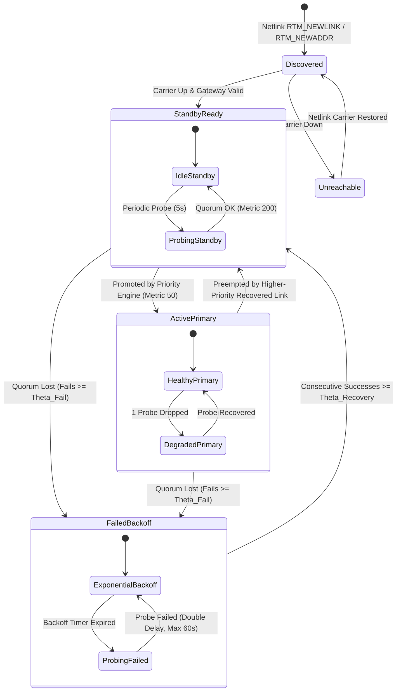
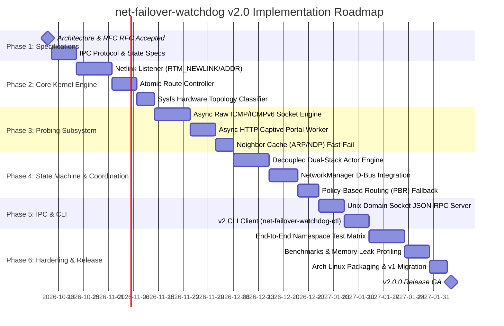

# net-failover-watchdog v2.0: Architecture & Design Specification

> **Status**: Accepted RFC / Target Design  
> **Current Version**: 1.1.0 (Bash / Subprocess Engine)  
> **Target Version**: 2.0.0 (Compiled Systems Daemon / Netlink Event Loop)  
> **Target Language**: Rust (Async `tokio` + `rtnetlink` + `zbus`)  
> **Target Platforms**: Linux (kernel $\ge 5.10$) with NetworkManager, systemd-networkd, or standalone routing

---

## 1. Executive Summary & Problem Statement

### 1.1 Background
The current `net-failover-watchdog` v1.1.0 is an enterprise-hardened Bash daemon that manages multi-WAN failover on Linux desktops, edge devices, and mobile workstations switching between Ethernet, USB cellular modems, and Wi-Fi. It provides sysfs hardware classification, declarative configuration validation, asymmetric hysteresis, adaptive backoff, and dual-stack IPv6 default route synchronization.

### 1.2 Limitations of the v1.x Architecture
While robust, the shell-based design carries architectural constraints inherent to subprocess-driven scripting:

1. **Subprocess Spawning Overhead**:
   - Each monitoring loop spawns 10–25 short-lived processes (`ip`, `ping`, `curl`, `awk`, `sed`, `cut`).
   - On battery-constrained laptops or resource-constrained embedded systems, this causes continuous context switching and periodic CPU wakeups.
2. **Polling vs. Event-Driven Reactivity**:
   - v1.x checks interface state every `CHECK_INTERVAL` (default 3 seconds). Physical link disconnections (cable pull, USB unplug) are not reacted to until the next loop timer ticks.
3. **Route Table Contention ("Dual-Master" Problem)**:
   - NetworkManager and `systemd-networkd` own `table main`. When a DHCP lease renews or Wi-Fi reconnects, the network manager pushes default routes with its own metrics.
   - v1.x actively deletes or replaces these routes. Under high churn, this creates a race condition between the shell script and the system network manager.
4. **Coupled Dual-Stack State**:
   - v1.x synchronizes IPv6 routes based on IPv4 interface health. If an ISP drops IPv6 transit while IPv4 remains functional, v1.x cannot independently fail over IPv6 while keeping IPv4 on the primary link.
5. **Privilege Granularity**:
   - Running as a Bash script requires elevated permissions (`root`), making fine-grained privilege separation and seccomp filtering difficult to enforce.

### 1.3 Goals of v2.0
v2.0 transitions `net-failover-watchdog` into a compiled, high-performance Linux systems daemon with:
- **Zero Subprocess Spawning**: All operations use direct kernel syscalls, Netlink sockets, and async sockets.
- **Sub-Millisecond Event Reactivity**: Immediate response to kernel link state changes via `rtnetlink` multicast subscriptions.
- **Cooperative Network Manager Integration**: Native D-Bus and Policy-Based Routing (PBR) mechanisms eliminating route flapping conflicts.
- **Decoupled Dual-Stack State Machines**: Independent parallel health state tracking for IPv4 and IPv6.
- **Least-Privilege Execution**: Non-root daemon running with ambient Linux capabilities (`CAP_NET_ADMIN`, `CAP_NET_RAW`) and strict seccomp filters.

---

## 2. Architecture Comparison: v1.x vs v2.0

| Architectural Dimension | v1.1.0 (Current) | v2.0.0 (Target) |
| :--- | :--- | :--- |
| **Implementation Language** | Bash 5.x + GNU Coreutils | Rust (safe systems code, zero GC) |
| **Kernel Interface** | Forked `ip route` / `ip link` subshells | Direct `AF_NETLINK` (`NETLINK_ROUTE`) sockets |
| **Link State Detection** | Periodic polling (`/sys/class/net/*/carrier`) | Kernel multicast events (`RTM_NEWLINK` / `RTM_DELLINK`) |
| **Layer 3 Health Probes** | Forked `ping -I <iface>` processes | Async raw ICMP/ICMPv6 socket engine with `SO_BINDTODEVICE` |
| **Layer 7 Health Probes** | Forked `curl --interface` processes | Async HTTP/1.1 client with connection reuse & interface binding |
| **Route Ownership Model** | Destructive replacement in `table main` | Cooperative NetworkManager D-Bus or Policy Routing Tables (`100`/`200`) |
| **IPv4 / IPv6 Architecture** | Coupled (IPv6 follows IPv4 health) | Independent decoupled state machine actors per family |
| **Process Overhead** | 10–25 fork/execs per cycle (~2–5% CPU wake) | 0 fork/execs after startup (< 0.1% CPU, < 5 MB RAM) |
| **Security & Sandboxing** | Privileged script running as root | Dedicated unprivileged user (`netfailover`) + `CAP_NET_ADMIN` + seccomp |
| **IPC & Control Interface** | Signals (`SIGHUP`, `SIGUSR1`) + config rewrite | Unix domain socket (`SO_PEERCRED`) + typed JSON-RPC protocol |

---

## 3. System Architecture & Component Model

```
+-----------------------------------------------------------------------------------+
|                           Linux Kernel Subsystems                                 |
|                                                                                   |
|  [ Physical Links ]      [ FIB Routing Tables ]        [ Netlink Bus (rtnetlink) ] |
|   eth0, usb0, wlan0      table main / tables 100/200     RTM_NEWLINK / RTM_NEWROUTE |
+---------^--------------------------^---------------------------------^------------+
          |                          |                                 |
          | Raw Sockets              | Netlink Route Ops               | Event Stream
          | (ICMP/HTTP)              | (RTM_NEWROUTE / DEL)            | (Multicast)
+---------v--------------------------v---------------------------------v------------+
|                                                                                   |
|                     net-failover-watchdog v2.0 Core Daemon                        |
|                                                                                   |
|  +---------------------+   +---------------------+   +-------------------------+  |
|  | Netlink Event Loop  |   | Hardware Classifier |   | NetworkManager D-Bus    |  |
|  | - RTM_NEWLINK        |-->| - Sysfs Bus Walker  |-->| - org.freedesktop.NM    |  |
|  | - RTM_NEWADDR       |   | - Device Priorities |   | - Dynamic Metric Sync   |  |
|  +---------------------+   +---------------------+   +-------------------------+  |
|             |                         |                           |               |
|             v                         v                           v               |
|  +-----------------------------------------------------------------------------+  |
|  |                        Dual-Stack Routing Engine                            |  |
|  |                                                                             |  |
|  |   +------------------------------+     +------------------------------+     |  |
|  |   |   IPv4 Interface Actor       |     |   IPv6 Interface Actor       |     |  |
|  |   |   - Hysteresis Counter       |     |   - Hysteresis Counter       |     |  |
|  |   |   - Adaptive Backoff Timer   |     |   - Adaptive Backoff Timer   |     |  |
|  |   |   - Metric State (50/200/500)|     |   - Metric State (50/200/500)|     |  |
|  |   +--------------^---------------+     +--------------^---------------+     |  |
|  +------------------|------------------------------------|---------------------+  |
|                     |                                    |                        |
|  +------------------v------------------------------------v---------------------+  |
|  |                        Asynchronous Probing Engine                          |  |
|  |  - Async Raw ICMP / ICMPv6 Socket Pool (SO_BINDTODEVICE)                   |  |
|  |  - Async HTTP 204 Captive Portal Worker                                     |  |
|  |  - Local Gateway Fast-Fail (RTM_GETNEIGH / ARP / NDP)                       |  |
|  +-----------------------------------------------------------------------------+  |
|                                     ^                                             |
|                                     | Unix Domain Socket (/run/.../watchdog.sock) |
+-------------------------------------|---------------------------------------------+
                                      v
                      +-------------------------------+
                      |   net-failover-watchdog-ctl   |
                      |   (CLI Client via JSON-RPC)   |
                      +-------------------------------+
```

---

## 4. Kernel Event-Driven Subsystem (`rtnetlink`)

### 4.1 Netlink Socket Subscription
Instead of polling interface state, v2.0 establishes an asynchronous Netlink socket subscribed to kernel routing and link multicast groups:

```rust
// Netlink multicast group subscription mask
let groups = RTMGRP_LINK | RTMGRP_IPV4_IFADDR | RTMGRP_IPV6_IFADDR | RTMGRP_IPV4_ROUTE | RTMGRP_IPV6_ROUTE;
let socket = NetlinkSocket::bind(NETLINK_ROUTE, groups)?;
```

### 4.2 Message Handlers & Trigger Matrix

| Netlink Message | Kernel Trigger | Watchdog v2.0 Action |
| :--- | :--- | :--- |
| `RTM_NEWLINK` (`IFF_LOWER_UP` set) | Ethernet plugged in / Wi-Fi connected | Trigger instant zero-delay health probe without waiting for next loop cycle. |
| `RTM_DELLINK` / `IFF_LOWER_UP` cleared | Cable pulled / USB unplugged / Wi-Fi drop | **Instant failover**: Demote interface immediately, promote highest-priority standby link. |
| `RTM_NEWADDR` | DHCP lease acquired / IP address added | Ingest new IP and gateway; register interface into the active probing pool. |
| `RTM_DELADDR` | IP address lost / DHCP expired | Demote interface; clear associated routing entries. |
| `RTM_NEWROUTE` | NetworkManager / systemd-networkd pushes route | Inspect route metric; coordinate with manager or override if conflicting. |
| `RTM_GETNEIGH` / `RTM_NEWNEIGH` | ARP/NDP neighbor state update | Detect gateway unreachable state (`NUD_FAILED`) for instant local fast-fail. |

---

## 5. Network Manager Coexistence & Route Ownership

### 5.1 The Dual-Master Problem
When `NetworkManager` or `systemd-networkd` controls network interfaces, they configure default routes with default metrics (typically `100` for Ethernet, `600` for Wi-Fi). When `net-failover-watchdog` v1.x modifies `table main`, the following conflicts occur:
1. **DHCP Renewal Race**: A DHCP renewal triggers the network manager to re-assert its default route, overriding watchdog metrics.
2. **Reconnection Clashing**: When Wi-Fi reconnects, NetworkManager writes a default route with metric 600, potentially taking precedence if watchdog marked degraded links at 500.

### 5.2 v2.0 Dual-Mode Solution

#### Mode A: Cooperative D-Bus Orchestrator (Default on Desktop/Workstation)
v2.0 coordinates directly with NetworkManager over the system D-Bus (`org.freedesktop.NetworkManager`):

```
+------------------------------------+           D-Bus: Set Connection Metric
|     net-failover-watchdog v2.0     | ------------------------------------------------+
+------------------------------------+                                                 |
                  |                                                                    v
                  | Direct Netlink Probe                               +-------------------------------+
                  v                                                    |        NetworkManager         |
    +---------------------------+                                      +-------------------------------+
    | Verified Interface Health |                                                      |
    | eth0: Primary (Metric 50) |                                                      v Updates FIB
    | wlan0: Backup (Metric 200)|                                      +-------------------------------+
    +---------------------------+                                      |      Kernel table main        |
                                                                       +-------------------------------+
```

- When an interface is promoted, v2.0 calls `Update2` on `org.freedesktop.NetworkManager.Settings.Connection` to set:
  - `ipv4.route-metric = 50`
  - `ipv6.route-metric = 50`
- Standby interfaces are set to metric `200`; degraded links are set to metric `500`.
- **Advantage**: NetworkManager retains ownership of the FIB; DHCP renewals preserve watchdog-assigned metrics; zero routing table churn.

#### Mode B: Policy-Based Routing (Autonomous / Headless Edge Mode)
On systems without NetworkManager (or when running standalone), v2.0 uses kernel **Policy-Based Routing (PBR)** tables:
- **Table 100**: Contains default route for the Primary interface.
- **Table 200**: Contains default route for the Standby interface.
- Routing rules managed via `ip rule` / `RTM_NEWRULE`:
  ```bash
  ip rule add pref 1000 lookup 100
  ip rule add pref 2000 lookup 200
  ```
- **Advantage**: Leaves `table main` completely untouched. Even if NetworkManager, `dhcpcd`, or `systemd-networkd` writes default routes to `table main`, watchdog's policy rules at preference 1000 take absolute precedence.

---

## 6. Decoupled Dual-Stack State Machine Architecture

### 6.1 State Machine Actor Model
In modern networks, IPv4 and IPv6 routing paths frequently diverge:
- An ISP may have broken IPv6 BGP routing while IPv4 works properly.
- A cellular provider may use pure IPv6 with NAT64/DNS64.
- Forcing IPv6 to follow IPv4 status causes Happy Eyeballs (RFC 8305) clients to experience timeouts.

v2.0 models each interface as a pair of decoupled actor state machines:
`InterfaceActor<IPv4>` and `InterfaceActor<IPv6>`.

### 6.2 State Transition Diagram



### 6.3 Hysteresis & Metric Contract

| Actor State | Metric Assigned | Health Conditions | Routing Behavior |
| :--- | :--- | :--- | :--- |
| **`ActivePrimary`** | `50` | Quorum verified; highest active priority rank | Handles all default outbound traffic |
| **`StandbyReady`** | `200` | Carrier UP, gateway reachable, quorum verified | Warm standby; instantly promoted on primary failure |
| **`DegradedPrimary`**| `50` | 1–2 intermittent probe drops ($\text{drops} < \Theta_{\text{fail}}$) | Kept active to avoid premature failover during transient blips |
| **`FailedBackoff`** | `500` / Removed | $\ge \Theta_{\text{fail}}$ consecutive drops | Demoted; probed on adaptive backoff ($3\text{s} \to 60\text{s}$) |
| **`Unreachable`** | No route | Carrier down, cable unplugged, or no IP address | Route purged from FIB / routing table |

---

## 7. High-Performance Probing Subsystem

### 7.1 Async Raw ICMP / ICMPv6 Engine
Instead of executing `ping -I <dev> <target>`, v2.0 implements an asynchronous raw socket ICMP client:
- Single socket per address family: `AF_INET` (`IPPROTO_ICMP`) and `AF_INET6` (`IPPROTO_ICMPV6`).
- Packets bound to specific egress interfaces using `SO_BINDTODEVICE`.
- Asynchronous event loop (`tokio` / `epoll`) monitors packet reception.
- Each echo request contains a typed payload embedding:
  - Interface Index (`u32`)
  - Sequence Counter (`u16`)
  - Nanosecond Timestamp (`u64`)
- Incoming replies match outstanding probes in $\mathcal{O}(1)$ time, measuring exact RTT latency and jitter with zero subprocess creation.

### 7.2 Async Layer 7 Captive Portal Verification
- Native non-blocking HTTP/1.1 client.
- Sockets bound to specific interfaces via `SO_BINDTODEVICE` before issuing TCP `connect()`.
- Probes endpoints expecting HTTP 204 No Content:
  - `http://connectivitycheck.gstatic.com/generate_204`
  - `http://cp.cloudflare.com/generate_204`
- If an HTTP 302/301 redirect or HTML payload is returned, the interface is flagged as `CaptivePortalBlocked` and prevented from becoming primary.

### 7.3 Local Gateway Fast-Fail (Neighbor Cache Introspection)
- Rather than waiting for external Anycast pings to time out when a local router crashes, v2.0 subscribes to `RTM_GETNEIGH` / `RTM_NEWNEIGH` Netlink messages.
- If the default gateway's ARP (IPv4) or NDP (IPv6) entry transitions to `NUD_FAILED` or `NUD_INCOMPLETE`, the link is marked failed within $< 500\text{ ms}$.

---

## 8. Security, Privilege Sandboxing, & IPC Architecture

### 8.1 Least-Privilege Execution
v2.0 drops full root execution:
1. The daemon starts as `root`, creates raw ICMP and Netlink sockets, and binds to required system resources.
2. Immediately drops UID and GID to a dedicated system service user: `netfailover:netfailover`.
3. Retains only two Linux ambient capabilities (`PR_CAP_AMBIENT_RAISE`):
   - `CAP_NET_ADMIN`: Required for Netlink route manipulation and interface binding.
   - `CAP_NET_RAW`: Required for raw ICMP socket generation.
4. Drops all other privileges (`CAP_SYS_ADMIN`, `CAP_DAC_OVERRIDE`, etc.).

### 8.2 Systemd Sandboxing Profile
```ini
[Service]
User=netfailover
Group=netfailover
AmbientCapabilities=CAP_NET_ADMIN CAP_NET_RAW
CapabilityBoundingSet=CAP_NET_ADMIN CAP_NET_RAW
NoNewPrivileges=yes
ProtectSystem=strict
ProtectHome=yes
ProtectKernelTunables=yes
ProtectControlGroups=yes
PrivateTmp=yes
RestrictAddressFamilies=AF_INET AF_INET6 AF_NETLINK AF_UNIX
MemoryDenyWriteExecute=yes
SystemCallFilter=@system-service @network-io
SystemCallErrorNumber=EPERM
```

### 8.3 Unix Domain Socket IPC (`net-failover-watchdog-ctl`)
- Unix domain stream socket located at `/run/net-failover-watchdog/watchdog.sock`.
- Permission: `0660`, owned by `netfailover:wheel`.
- Connection verification via `SO_PEERCRED` ensures that only authorized users (root or `wheel` members) can issue commands.
- Protocol: Compact JSON-RPC 2.0 over length-delimited streaming messages:
  - `status`: Returns live interface state, RTT latency, packet loss, and active routes.
  - `set_priorities`: Reconfigures hardware class or interface precedence on the fly.
  - `force_failover`: Manually demotes an active link for testing or maintenance.
  - `pause` / `resume`: Pauses route manipulation during network maintenance.

---

## 9. Technology Selection: Why Rust?

| Criterion | Rust | Go | C / C++ |
| :--- | :--- | :--- | :--- |
| **Memory Safety** | Guaranteed at compile time (no buffer overflows, safe concurrency) | Memory safe (garbage collected) | Manual memory management (risk of memory corruption) |
| **Runtime / GC Latency** | **Zero GC pauses**; deterministic latency on network events | GC runtime pauses can cause jitter in sub-millisecond timers | Zero GC pauses |
| **Async Ecosystem** | First-class (`tokio`, `rtnetlink`, `zbus`, `hyper`) | Strong (`goroutines`, `netlink`) | Complex event loops (`libuv`, `libevent`) |
| **Binary Footprint** | Statically linked, stripped binary $\approx 3.5\text{ MB}$ | Statically linked binary $\approx 12–15\text{ MB}$ | Small binary $\approx 1.5\text{ MB}$, dynamic library dependencies |
| **Resource Usage** | $< 5\text{ MB}$ RSS, zero background thread overhead | $\approx 15–25\text{ MB}$ RSS due to Go runtime overhead | $< 3\text{ MB}$ RSS |

**Decision**: Rust is selected as the primary implementation language for v2.0 due to compile-time safety, absence of garbage-collection jitter, and robust Netlink/D-Bus crate ecosystems.

---

## 10. Phased Implementation Roadmap



### Milestone Deliverables

#### Milestone 1: Core Kernel Netlink & Route Engine (Phase 2)
- Functional `rtnetlink` event loop receiving link state notifications.
- Route manipulation engine setting metrics and policy routes atomically without forking `ip`.
- Sysfs bus introspection classifying `/pci...`, `/usb...`, and `phy80211` devices.

#### Milestone 2: Probing & Fast-Fail Engine (Phase 3)
- Non-blocking ICMP/ICMPv6 raw socket worker with nanosecond RTT telemetry.
- HTTP 204 captive portal validation with per-interface egress binding.
- Kernel neighbor cache listener detecting local gateway failure.

#### Milestone 3: Decoupled Dual-Stack State Machine & D-Bus (Phase 4)
- Independent IPv4 and IPv6 state actors.
- Asymmetric hysteresis ($\Theta_{\text{fail}} = 3$, $\Theta_{\text{recovery}} = 10$).
- Native NetworkManager D-Bus `Update2` integration and PBR table fallback.

#### Milestone 4: Production Release & Migration (Phase 5 & 6)
- High-speed Unix domain socket IPC with peer credential security.
- Comprehensive namespace test matrix matching and extending the v1.x suite.
- Memory leak profiling under Valgrind/Miri demonstrating $< 5\text{ MB}$ RSS.
- Updated `PKGBUILD` and migration guide from v1.x configuration.

---

## 11. Migration & Backward Compatibility Strategy

1. **Configuration Compatibility**:
   - v2.0 will ship with a configuration converter that parses existing `/etc/net-failover-watchdog.conf` files into the v2.0 format (`/etc/net-failover-watchdog/config.toml`), preserving existing probe targets, intervals, and hysteresis thresholds.
2. **CLI Parity**:
   - `net-failover-watchdog-ctl` commands (`status`, `set-priority`, `reset-priority`, `list`) will maintain full parameter and output compatibility with existing automation scripts.
3. **Coexistence Mode**:
   - The v2.0 systemd service replaces `net-failover-watchdog.service` cleanly via package conflicts/replaces directives in Arch Linux `PKGBUILD`.
